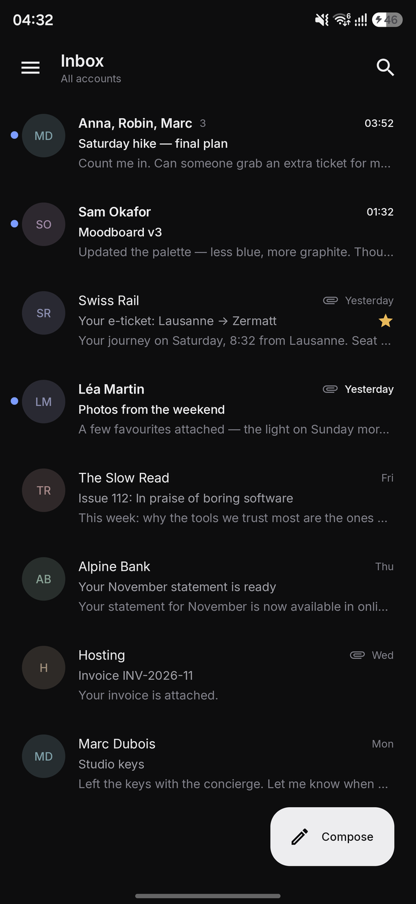
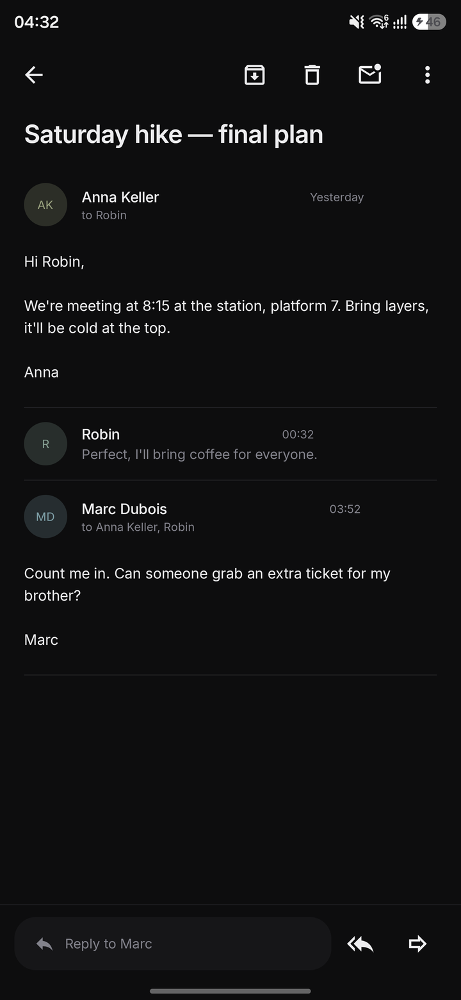
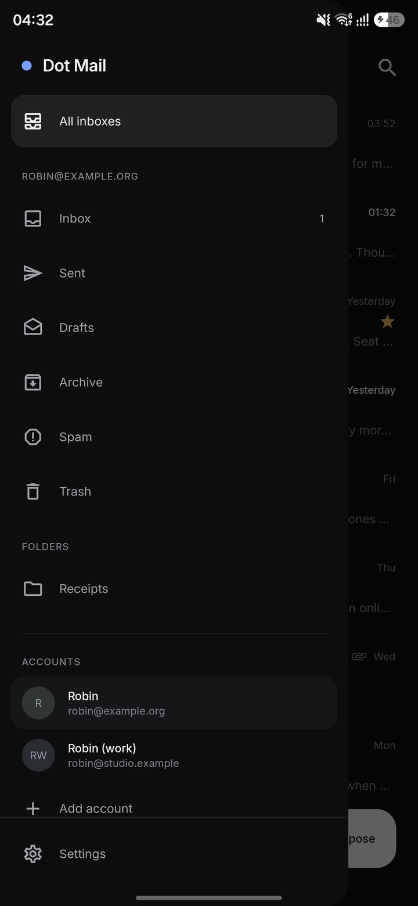

<div align="center">


# Dot Mail

**Your mail. Nothing else.**

A calm, fast, fully native Android email client that talks straight to your provider —<br/>
no account with us, no servers in between, no ads, no tracking. Free software, forever.

[Features](#what-it-does) · [Privacy](#privacy-by-construction) · [Screenshots](#a-quiet-interface) · [Build](#build-it) · [Status](#status) · [Contribute](CONTRIBUTING.md)

</div>

---

## Why another mail app?

Because the good-looking ones read your mail, and the private ones look like 2009.

Dot Mail is built on a simple promise: **an interface as refined as the best commercial apps, with the
independence of the best open-source software.** It connects to any standard IMAP/SMTP server —
Infomaniak, Gmail, Fastmail, iCloud, mailbox.org, Posteo, your own server — and keeps everything
between your phone and your provider.

## A quiet interface

<div align="center">

| Inbox | Conversation | Mailboxes |
|:---:|:---:|:---:|
|  |  |  |

<sub>Screenshots from the built-in demo mode on a Galaxy S25 Ultra — sample data, not real mail.</sub>

</div>

The design language — we call it **Quiet** — is near-monochrome: graphite and paper surfaces, hairline
separators, one restrained accent for what's new, and typography doing the work colour usually does.
No confetti of Material You colours, no pill buttons everywhere, no shadows stacked on shadows.
Light and dark themes are designed separately, not inverted.

It's meant to disappear so your mail can be read.

## What it does

**Everyday mail, done properly**
- Multiple accounts and a **unified inbox**; switch accounts from a ChatGPT-style sidebar
- **Conversations**: replies grouped into threads (References / In-Reply-To, Gmail thread ids)
- Read, star, archive, delete, spam, move — on one message or many, with **configurable swipes**
- **Offline-first**: everything you've synced is readable without a connection; actions queue and replay
- Fast **search** across all accounts, locally and on the server, with operators:
  `from:` `to:` `subject:` `has:attachment` `is:unread` `is:starred` and "quoted phrases"
- **Outbox** you can trust: undo send, scheduled send, and no silent duplicates — if a connection dies
  mid-send, Dot Mail asks before sending again

**Reading**
- Plain-text and HTML mail, inline images, attachments (open or share with any app)
- Quoted replies folded away; long threads stay readable
- Full sender/recipient details on demand

**Writing**
- Reply, reply all, forward, drafts saved as you type and recovered after a crash
- Recipient chips with suggestions from people you've written with — no contacts permission needed
- Attach files from anywhere via the system picker; share files *into* Dot Mail from other apps
- Works as your default mail app (`mailto:` links)

**Android, natively**
- 100 % Kotlin and Jetpack Compose. No WebView UI, no cross-platform layer
- Edge-to-edge, predictive back, system light/dark, Android autofill for passwords
- Per-account notification channels with **Mark read** / **Archive** actions
- Home-screen shortcuts (Compose, Search); background sync that respects Doze and your battery

## Privacy by construction

| | |
|---|---|
| **No middleman** | Dot Mail connects directly to your mail server over TLS. There is no Dot Mail server. |
| **No tracking** | No analytics, no crash reporters, no ads, no Google Play Services. Not "opt-out" — absent. |
| **Remote images blocked** | Tracking pixels never load unless you tap *Load* for a message, or allow it globally. |
| **Hardened HTML** | Mail HTML is sanitised, then shown in a WebView with JavaScript, file access, Safe Browsing pings and all network requests disabled. |
| **Honest links** | Before leaving the app, you see where a link really goes. |
| **Encrypted secrets** | Passwords are encrypted with a key held in the Android Keystore. |
| **Stays on your phone** | Excluded from cloud backup and device transfer. Optional app lock (fingerprint / face / PIN) and "hide in Recents". |

The only third party ever contacted is optional: when you add an account, Dot Mail may ask Mozilla's public
ISPDB for your **domain's** server settings (never your address) if it doesn't already know your provider.

## Getting started

1. Install the APK from [Releases](https://github.com/Sr-0w/Dot-Mail/releases).
2. Enter your email address and password. For Gmail, iCloud and Yahoo, use an **app password**.
3. That's it — Dot Mail finds your servers automatically, or lets you enter them by hand.

Tested end-to-end against **Infomaniak** (IMAP 993 TLS, SMTP 587 STARTTLS and 465 TLS) and a local
GreenMail server in CI-style tests.

## Status

Dot Mail is **young**. It's usable and tested, but not yet battle-hardened on thousands of mailboxes.
Here is exactly where it stands — see [docs/FEATURES.md](docs/FEATURES.md) for the full matrix.

| Works today | Not yet |
|---|---|
| IMAP/SMTP with password or app password, Google sign-in | Microsoft (Outlook/Hotmail/Live) accounts: not supported |
| Unified inbox, threads, search, folder management | Push while the app is closed (sync every 15 min instead) |
| Offline cache, queued actions, background sync, IDLE while open | Calendar invitation UI (the .ics parser is done) |
| Rich-text or plain-text composing, aliases with signatures | S/MIME |
| Undo / scheduled send, drafts, attachments | Second-exact scheduled delivery (Android may delay background work) |
| Remote images per message, sender or domain — remembered | |
| Notifications with actions, app lock, home-screen widget | |

## Build it

You need JDK 17+ and the Android SDK (platform 35).

```bash
git clone https://github.com/Sr-0w/Dot-Mail.git
cd Dot-Mail
./gradlew assembleDebug        # → app/build/outputs/apk/debug/app-debug.apk
./gradlew test                 # JVM + Robolectric tests (engine runs against a real in-process IMAP/SMTP server)
```

Want to look around without an account? Debug builds have a **demo mode** (Settings → Demo mode) with
sample mail and no network at all.

## How it's built

```
:app           Compose UI, navigation, screens            ─┐
:designsystem  "Quiet" tokens + components (suite-wide)    │  depends on
:data          Room cache, sync workers, outbox, Keystore  ─┤
:mail          Pure-JVM IMAP/SMTP/MIME engine (Jakarta Mail), HTML sanitiser, autodiscovery
```

Read [docs/ARCHITECTURE.md](docs/ARCHITECTURE.md) for the data flow, sync model, outbox state machine and
security model.

## The Dot suite

Dot Mail is the first of a family of independent, privacy-respecting Android apps sharing one design
language — Messages, Calendar, Contacts, Notes and more to come. The `:designsystem` module is where that
family resemblance lives.

## Made by a small team of AI agents

Dot Mail is developed by a coordinated team of AI engineering agents — Claude (lead, design system and UI),
Codex (mail engine, sync, security), Sonnet (UI tests), Gemini (design and accessibility review) and Qwen
(autodiscovery, text processing, docs) — under the direction of its human owner. Every change is built and
tested before it lands; reports from each agent live in [`docs/reports`](docs/reports).

## Licence

[GNU GPL v3.0 or later](LICENSE). Typeface: [Inter](https://rsms.me/inter/) (SIL Open Font License).
