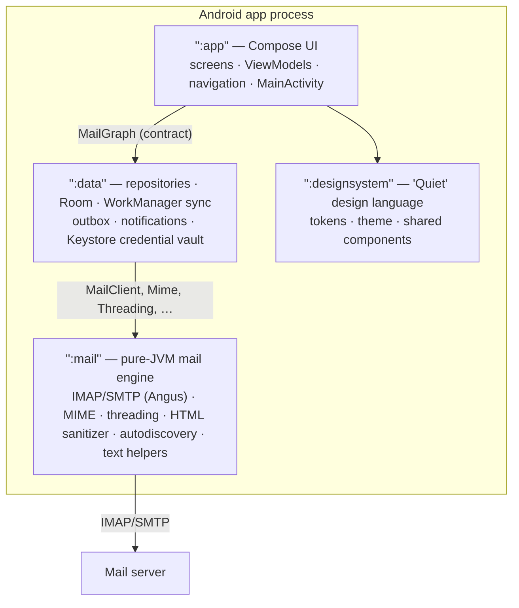
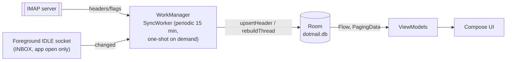

# Dot Mail — Architecture

This document describes how the code is actually organised today (read from the sources,
2026-11). Where a detail is an assumption rather than something verified in code, it is
marked **TODO verify**.

## 1. Modules



Dependency rules:

- `:mail` is **pure JVM** — no `android.*` imports, no I/O other than the mail protocols.
  It can (and does) run unit tests on the plain JVM against GreenMail.
- `:data` owns all persistence and background work. Its public surface is the
  **contract** below; it depends on `:mail`.
- `:app` renders and navigates. It depends on `:data` (through the contract only) and on
  `:designsystem`.
- `:designsystem` is UI-agnostic Compose: tokens (`Dot.colors`, `Dot.type`, `DotSpacing`),
  `DotTheme(mode)`, components (buttons, top bars, avatars, snackbar…). It is intended to
  be reused by future Dot apps.

There is deliberately **no DI framework**: `DotMailApp.onCreate` calls
`createMailGraph(context)` once (in `data/.../RealMailGraph.kt`) and exposes it plus
`AppSettings` via two `CompositionLocal`s (`LocalMailGraph`, `LocalSettings`).

## 2. The contract

| File | What |
|---|---|
| `data/.../model/Models.kt` | Shared domain models: `Account`, `Identity`, `SyncState`, `Folder`, `Mailbox` (Unified / InFolder), `ThreadSummary`, `Message`, `MessageBody`, `Attachment`, `MessageAction`, `Draft`, `OutboxItem`/`OutboxState`, `AccountConfig`/`ServerConfig`/`AuthType`/`Security`, `VerifyResult`. Timestamps are epoch ms. |
| `data/.../Repositories.kt` | `AccountRepository` (discover / verify / add / remove), `MailRepository` (folders, threads, search, thread, loadBody, openAttachment, apply, move, refresh, suggestContacts), `ComposeRepository` (outbox, retrySend, deleteOutbox, saveDraft, loadDraft, discardDraft, prepareReply, send, cancelSend), and the `MailGraph` facade. |

The contract's rules (from the file itself): reads are `Flow`s over the local database
(always offline-first); writes apply locally and immediately, never throw for network
reasons; suspend functions are main-thread safe.

## 3. Read path: UI ← Flow/Paging ← Room ← sync workers ← IMAP



**Header-first sync.** `MailClient.sync` (per folder) transfers *no message content*:
ENVELOPE, FLAGS, BODYSTRUCTURE (attachment detection only), UIDs, and the Gmail
`X-GM-THREADID` item when the server advertises `X-GM-EXT-1` (registered via a
`GmailThreadFetch` IMAP protocol hook in `EngineImapStore`). Progress is incremental via a
per-folder cursor (`uidValidity`, `uidNext`, `highestModSeq`):

- if `uidValidity` changed → **reset**: refetch the newest 30 days, newest 500 headers;
- otherwise fetch UIDs `cursor.uidNext … LASTUID` (page limit 500; the cursor only
  advances past a full page — a partial page is re-fetched next time).

Flag changes without new mail are reconciled with **CONDSTORE**
(`UID CHANGEDSINCE highestModSeq`) when the server supports it; otherwise a full UID
inventory is fetched (UIDs only) to detect expunges. The result (`HeaderSync`: cursor,
reset flag, new headers, changed flags, existing-UID set) is applied in one Room
transaction (`syncAll` in `data/.../Sync.kt`): unknown UIDs are deleted, new headers are
upserted (`upsertHeader`), flags are merged, every touched thread is rebuilt
(`rebuildThread`), and the folder row stores the new cursor and the server-side
unread/total counts.

**Threads.** `Threading.keys` (in `:mail`) maps a header to identity keys, highest signal
first: `gmail:<threadId>` (Gmail servers), `id:<first References>`, `id:<In-Reply-To>`,
`id:<Message-ID>`, `subject:<normalised subject>` (Re:/Fwd:/Aw:/Sv: prefixes stripped,
whitespace collapsed, lowercased). Keys are stored per account in `thread_keys`; the first
existing key resolves the thread, otherwise a new `threads` row is created.

**Bodies are lazy.** `ThreadSummary` rows carry only a snippet (180 chars, whitespace
collapsed). `Message.body` is `null` until `MailRepository.loadBody` fetches the full
message (`MailClient.body`, hard 25 MiB cap, then `Mime.parse` — multipart walk with a 40
level depth limit). Plain text and HTML are stored; HTML is stored **raw and
unsanitised** and only sanitised at render time (§6). Attachments are written to
`filesDir/attachments/<accountId>/<uuid>/<safe-name>` and exposed as `content://` URIs via
a FileProvider; opening one re-uses the file or downloads first.

**Search** is hybrid: local instant results (SQL `LIKE` with `!` escapes over
sender/recipient/subject/snippet/body, operators `from:`, `to:`, `subject:`,
`has:attachment`, `is:unread`, `is:starred` — parsed by `MailSearch`, shared between local
and server) plus a background server-side IMAP SEARCH per folder whose results are
upserted into the same tables (`RealMailGraph.search`).

**Notifications.** Fresh, unseen INBOX messages (sync only, not reset) raise a
per-account-channel notification (`MailNotifications`), `VISIBILITY_PRIVATE`, with
*Mark read* / *Archive* actions that go through `NotificationActionReceiver` → the same
optimistic write path (§4). On Android 13+ the `POST_NOTIFICATIONS` permission is checked
but not requested anywhere in the app — without it notifications are silently skipped
(**TODO verify** whether that is intended for v0.1).

**List paging.** `threads(mailbox)` is a `Pager(pageSize = 40)` over a raw SQL query on
`threads` scoped to the mailbox (unified = EXISTS against messages in folders of that
role; single folder = EXISTS in that folder), observed through Room.

## 4. Write path: optimistic local + queued server operations

Every user-visible action (read/unread, star, archive, trash, spam, not-spam,
delete-forever, move) follows the same pattern in `RealMailGraph.apply` / `move`:

1. **Local DB, in a transaction, immediately**: update flags, or move the message to the
   target folder, or delete it. Moved messages get a *negative* local uid
   (`uid = -message.id`) meaning "awaiting server reconciliation".
2. **Queue the server operation**: an `operations` row
   (`accountId, folderId, uidValidity, uid, action, target`).
3. **Wake the syncer**: `requestSync()` — a 300 ms debounce + de-duplicated
   WorkManager one-shot (`dotmail.sync`, network constraint, expedited if possible).

During the next `syncAll`, queued operations for that folder are **replayed** against the
server, one by one:

- if the folder's `uidValidity` changed in the meantime the operation is not executed —
  it is marked `“UIDVALIDITY changed; operation requires review”` and the account shows a
  sync-error banner;
- `MOVE` uses the IMAP `MOVE` extension when available; otherwise COPY + `\Deleted` +
  *targeted* `UID EXPUNGE` (which requires `UIDPLUS`). Without targeted expunge the copy
  succeeds but the original only disappears on the server's next global expunge — this is
  surfaced as a "deferred expunge" sync note rather than silently lying;
- `DELETE_FOREVER` uses `\Deleted` + targeted expunge and **requires** `UIDPLUS`
  (a generic EXPUNGE would delete messages marked by *other* clients);
- on operation failure the row keeps its `attempts`/`error` and sync reports
  "Some server changes are pending or require review".

Local state always wins in the meantime: `upsertHeader` will not overwrite the
unread/starred flags of a message that still has a pending operation for its uid.

Cross-account moves are explicitly unsupported (server `MOVE` is per-store).

## 5. Outbox and undo-send

Sending is fully queued and crash-safe. `OutboxItem` states (Room `state` strings):

```mermaid
stateDiagram-v2
  [*] --> PENDING: send(draft, undoWindow)
  PENDING --> CANCELLED: cancelSend() "undo" (CAS)
  PENDING --> SUBMITTING: deliverOutbox, MIME built + saved
  SUBMITTING --> PENDING: SMTP failed *before* envelope (safe retry)
  SUBMITTING --> UNCERTAIN: process died / SMTP ambiguous after DATA
  SUBMITTING --> APPEND: accepted; non-Gmail: save Sent copy
  SUBMITTING --> SENT: accepted; Gmail/Googlemail: server files Sent itself
  APPEND --> APPENDING: IMAP APPEND in flight
  APPENDING --> SENT: copy appended
  APPENDING --> APPEND: copy failed (retry re-appends only)
  UNCERTAIN --> PENDING: retrySend(confirmPossibleDuplicate)
  PENDING --> DISCARDED: deleteOutbox() (local only; server mail never recalled)
  APPEND --> DISCARDED: deleteOutbox()
  UNCERTAIN --> DISCARDED: deleteOutbox()
  CANCELLED --> [*]: draft restored
  SENT --> [*]
  DISCARDED --> [*]
```

Key mechanics:

- **Undo window**: `send` stores `dueAt = max(now + undoWindow [0…60 s], scheduledAt)` and
  schedules a WorkManager one-shot with that initial delay. The UI shows "Sending… Undo"
  at the navigation root (`UndoSendHost` + `UndoSendBus`) so it survives leaving the
  compose screen; *Undo* calls `cancelSend`, which is a **compare-and-swap**
  (`UPDATE outbox SET state='CANCELLED' … WHERE id=? AND state='PENDING'`) and restores
  the draft. A scheduled send (`scheduledAt` set) shows no undo.
- **All transitions are CAS** (`transitionOutbox(id, expected, next)`), so two workers can
  never double-send.
- **Preparation happens before claiming submission**: the draft's attachments are frozen
  into local files (total 25 MiB cap, `content://` only, sanitized file names) and the
  MIME message is built (`Mime.build` — with header-injection guards: no CR/LF in
  addresses/subject/references, strict MIME-type check) and persisted as
  `filesDir/outbox/<accountId>/<id>.eml`. On retry the `.eml` is reparsed, so the exact
  submitted bytes are stable.
- **Duplicate safety**: if the process dies *after* `DATA` was accepted, the item becomes
  `UNCERTAIN` ("Delivery could not be confirmed. Check Sent before retrying.") and retry
  requires an explicit `confirmPossibleDuplicate` acknowledgement in the outbox UI
  (`OutboxScreen`).
- **Sent copy**: for non-Gmail servers the delivered `.eml` is IMAP-APPENDed to the Sent
  folder (`Bcc` header removed; a message with the same Message-ID is not appended twice —
  checked with a `HeaderTerm` search; flagged `\Seen`). Gmail/GoogleMail accounts skip
  this (the server files Sent itself — **TODO verify**).
- **Recovery on start**: `recoverOutbox()` (run once from `RealMailGraph.start`) flips
  leftover `SUBMITTING` → `UNCERTAIN`, `APPENDING` → `APPEND`, and reschedules all
  `PENDING`/`APPEND` items.

## 6. Security model

**Credentials** — `KeystoreCredentialVault`: an AES key generated in
`AndroidKeyStore` (alias `dotmail.credentials.v1`, GCM mode, non-extractable,
randomized-IV). The password is stored per account row as Base64(12-byte IV ‖
GCM ciphertext) with **AAD = the account email address**, so a copied ciphertext cannot
be decrypted under a different account. `Credentials` are only ever materialised in the
data layer, on `Dispatchers.IO`.

**Transport** — IMAP/SMTP sessions set `ssl.checkserveridentity=true` (hostname
verification) and, for STARTTLS endpoints, `starttls.required=true`. The autodiscovery
guess prefers SSL 993/465; no plaintext connection is ever guessed.

**HTML rendering (two layers)** —

1. `HtmlSanitizer` (`:mail`, jsoup): tag/attribute allowlist; CSS `style` is
   value-restricted (whitelisted properties, values must match a strict character set —
   no functions, URLs, at-rules, escapes, comments); `img src` may only be an app-provided
   `content://` URI (resolved from `cid:` references against cached inline parts) —
   remote `http(s)` images are stripped unless the user allows them; `srcset`/`background`
   removed; links get `rel="noreferrer noopener"`. The result reports
   `hasRemoteImages` / `blockedRemoteResources`.
2. `HtmlMessageView` (`:app`, WebView on top of the sanitised string): JavaScript off,
   DOM storage off, databases off, file access off, geolocation off, Safe Browsing off
   (it would phone home to Google with URLs), no multi-window/zoom; content is loaded with
   a **null base URL** (opaque origin); *every* subresource request is intercepted —
   `content:`/`data:` pass, `http(s):` passes only if remote images are allowed for that
   message, everything else gets an empty 204; main-frame navigation is intercepted and
   turned into a link action instead of in-WebView browsing.

**Remote content** is blocked by default (`UiPrefs.loadRemoteImages = false`). Per message,
a "load remote content" banner appears when the sanitizer blocked resources; allowing is
per-message (`ThreadViewModel.remoteAllowed`) or global (Settings).

**Links** open through a confirmation dialog when `UiPrefs.confirmLinks` is on
(`LinkDialog` in `ThreadScreen`), then `ACTION_VIEW`. Plain-text bodies get quoted-tail
collapsing via `engine.text.QuoteSplitter`.

**Device-level**: optional app lock (BiometricPrompt, `BIOMETRIC_STRONG|DEVICE_CREDENTIAL`
on Android 13+, re-locks when the app goes to the background), optional `FLAG_SECURE`
(hides Recents thumbnails, blocks screenshots), notifications are
`VISIBILITY_PRIVATE`, `allowBackup=false`.

**Attachments** open via FileProvider `content://` URIs with read grants; file names are
sanitized (no `/`, `\`, control chars, 180 char cap).

**No telemetry** — the manifest declares only `USE_BIOMETRIC`; there is no analytics,
crash reporting, or third-party SDK of any kind (see `CONTRIBUTING.md` hard rules).

## 7. Account setup flow

`AddAccountScreen` (`app/.../account/AccountSetup.kt`):

1. user types an address → `AccountRepository.discover(email)` runs `AutoDiscovery`
   (`:mail` engine/autoconfig): built-in table → provider autoconfig
   (`https://autoconfig.<domain>/mail/config-v1.1.xml`, then
   `https://<domain>/.well-known/autoconfig/mail/config-v1.1.xml`) → Mozilla ISPDB →
   `imap.<domain>:993 / smtp.<domain>:465` guess. URLs contain only the domain.
2. `verify(config, password)` logs into IMAP **and** connects SMTP without saving;
   failures map to `AuthFailed` / `ConnectionFailed` / `CertificateProblem`.
3. OAuth-only providers (Outlook personal, Proton) are surfaced with a provider hint and
   blocked: "requires browser sign-in (OAuth), which isn't available in this version
   yet". `AuthType.OAUTH2` is modelled end-to-end (`MailClient` sets the `XOAUTH2`
   mechanism when `Credentials.oauth2`), but **token acquisition is not implemented
   yet** (planned).
4. `addAccount` encrypts the password, stores the account (auto-assigned accent colour
   `index % 6`), and triggers the first sync. Any failure falls back to the manual
   host/port form (Step.Manual).

## 8. Background execution & battery model

- **WorkManager periodic** `dotmail.periodic`: every **15 min**, network-required,
  `KEEP` policy, exponential backoff 30 s. This is the only permanent scheduler.
- **WorkManager one-shots**: `dotmail.sync` (pull-to-refresh, after local writes, 300 ms
  debounced; expedited with `RUN_AS_NON_EXPEDITED` fallback) and `dotmail.outbox.<id>`
  (send timers, initial delay = undo/scheduled window).
- **IMAP IDLE** runs **only while the app is in the foreground** (`ForegroundIdle`
  observes `ProcessLifecycleOwner`): one dedicated IDLE socket per account on INBOX,
  reconnecting every 30 s on failure; any message-count/flag event triggers `requestSync`.
  There is no permanent foreground service by default (battery).
- Everything protocol-side runs on `Dispatchers.IO`; `MailClient` opens a fresh
  connection per operation (30 s timeouts; no shared selected folder).

## 9. Concurrency & state integrity

- One `RealMailGraph` per process (`GraphRegistry`, synchronized lazy init) — workers,
  receivers, ViewModels and the app object share it.
- A `Mutex` (`syncLock`) serializes `syncAll`, `deliverOutbox`, `loadBody`, `apply`,
  `move` and `serverSearch` — no concurrent IMAP/Room mutations from the data layer.
- Room CAS transitions protect the outbox state machine; `uidValidity`-tagged operations
  protect flag/move replay; negative uids mark locally-applied, server-pending messages.
- `MessageRow.header` stores a JSON subset (addresses, Message-ID, References,
  List-Unsubscribe); bodies/attachments are separate rows; everything is
  JSON-serialized by `data/.../Codec.kt` (plain `org.json`, no framework).

## 10. Demo mode & test doubles

`DemoMailGraph` (`app/.../demo/`) is an in-memory `MailGraph` with sample conversations,
used by screenshots, Compose UI tests, and "try the app without an account"
(`UiPrefs.demoMode`, debug builds only; `DemoTestRunner` forces it for instrumented
tests). Engine interop tests use GreenMail; data-layer tests use Robolectric + in-memory
Room + GreenMail; `LiveInfomaniakTest` (opt-in via `DOTMAIL_LIVE=1` +
`~/.config/dotmail/test-account.env`) exercises a real account end-to-end.

## 11. Key files

| Area | File |
|---|---|
| Contract (models) | `data/src/main/kotlin/app/dot/mail/data/model/Models.kt` |
| Contract (repositories) | `data/src/main/kotlin/app/dot/mail/data/Repositories.kt` |
| Repository impl + outbox + drafts + attachments | `data/.../RealMailGraph.kt` |
| Sync, replay, delivery | `data/.../Sync.kt` |
| WorkManager scheduling, workers, foreground IDLE | `data/.../WorkScheduling.kt` |
| Room schema + DAO | `data/.../local/MailDatabase.kt` |
| Credential vault (Keystore) | `data/.../CredentialVault.kt` |
| Notifications | `data/.../MailNotifications.kt` |
| IMAP/SMTP client | `mail/.../engine/MailClient.kt` (+ `EngineImapStore.kt`) |
| MIME build/parse | `mail/.../engine/Mime.kt` |
| Threading keys | `mail/.../engine/Threading.kt` |
| Search parsing | `mail/.../engine/MailSearch.kt` |
| HTML sanitizer | `mail/.../engine/HtmlSanitizer.kt` (+ thin `engine/html/` wrapper used by the UI) |
| Autodiscovery | `mail/.../engine/autoconfig/*` |
| Text helpers | `mail/.../engine/text/*` |
| App entry, settings, demo graph | `app/.../DotMailApp.kt`, `AppSettings.kt`, `demo/DemoMailGraph.kt` |
| Intents (mailto/SEND) | `app/.../MainActivity.kt` (`MailtoParser`) |
| Navigation + undo host | `app/.../ui/Navigation.kt` |
| Inbox (list, swipe, drawer) | `app/.../ui/inbox/*` |
| Thread + HTML view | `app/.../ui/thread/*` |
| Compose (drafts, recipients) | `app/.../ui/compose/*` |
| Outbox screen | `app/.../ui/outbox/OutboxScreen.kt` |
| Account setup | `app/.../ui/account/AccountSetup.kt` |
| Design tokens/theme | `designsystem/.../Tokens.kt`, `Theme.kt` |

## 12. Known limitations & open items

- **OAuth2**: modelled (discovery → setup UI → XOAUTH2 mechanism) but no token flow
  exists yet — Outlook personal and Proton accounts are intentionally blocked at setup.
- **Identities**: one implicit identity per account today (`AccountRow` doubles as the
  identity). Multiple identities/aliases are planned.
- **POP3**: not supported (IMAP only).
- **Encryption (OpenPGP/S-MIME)**: not implemented; planned.
- **Threading edge cases**: the subject-fallback key can merge unrelated conversations
  that share a subject and no Message-IDs; Gmail thread IDs are only used on
  `X-GM-EXT-1` servers.
- **Deferred expunge**: without targeted `UID EXPUNGE`, moved originals linger on the
  server until its next global expunge (surfaced as a sync note).
- **Notifications on Android 13+**: permission is checked, not requested in-app
  (**TODO verify** product intent).
- **Gmail auto-Sent assumption** (skip the APPEND phase for `imap.gmail.com` /
  `googlemail.com`): **TODO verify** on Google Workspace setups.
- `:designsystem` has no unit tests yet; it is covered indirectly by the `:app` UI tests.
